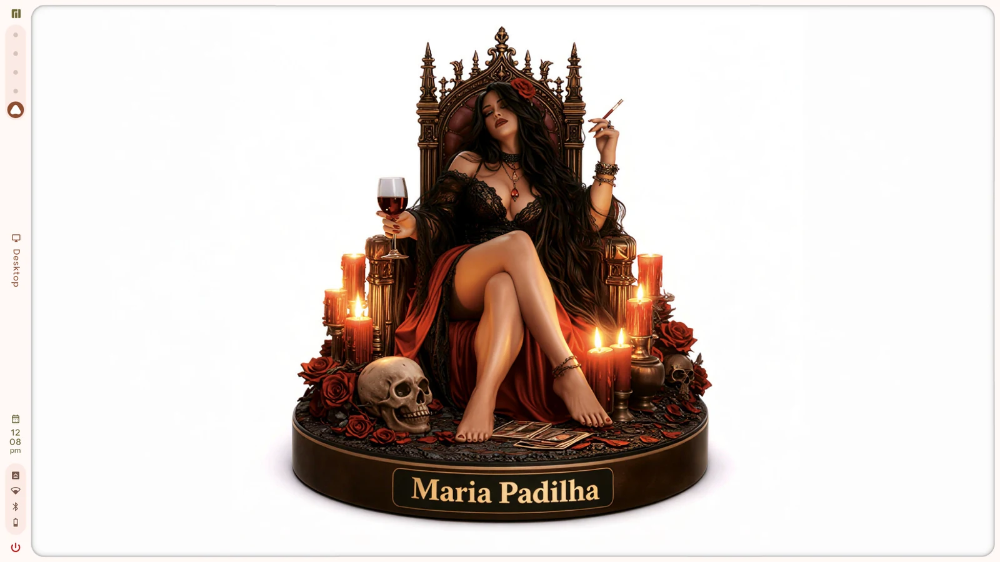
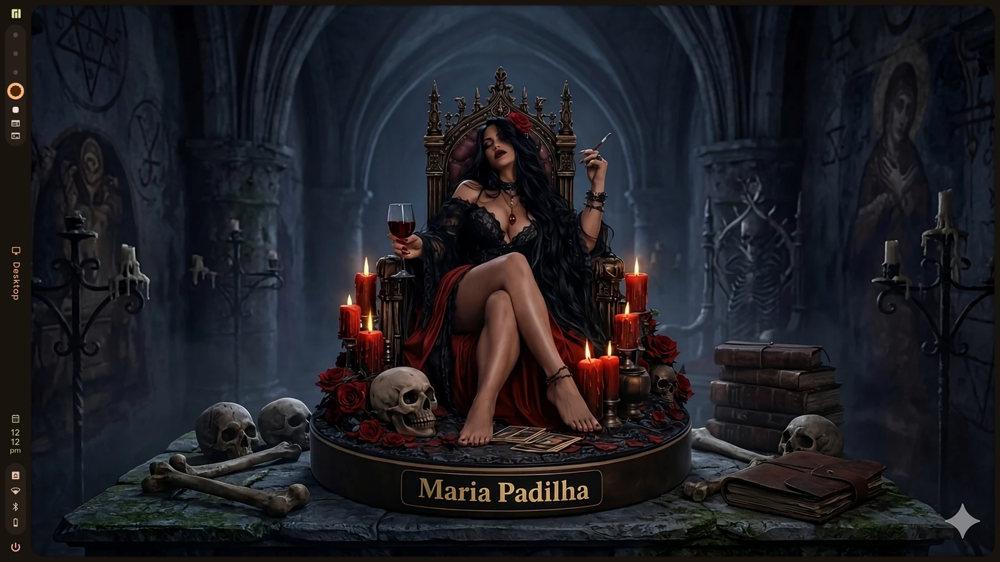
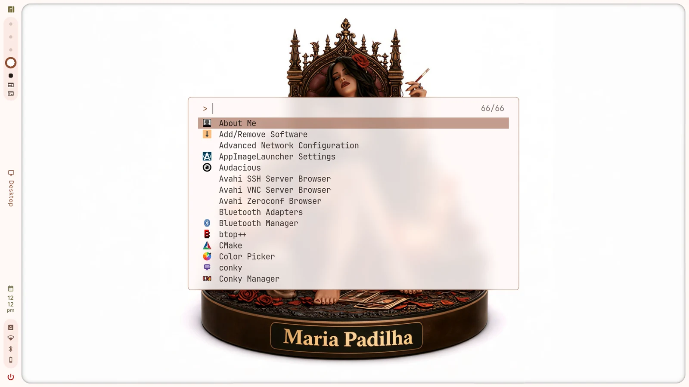
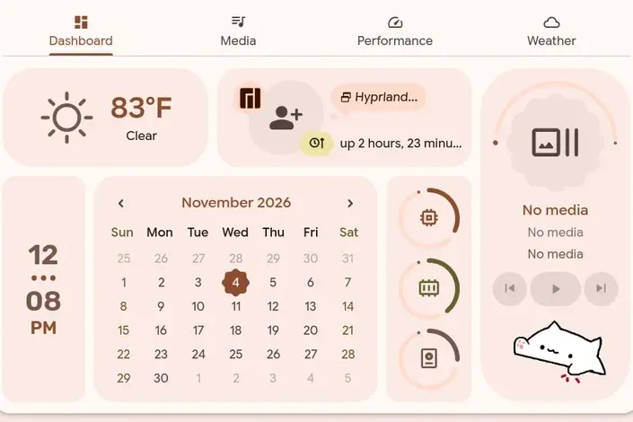

# Maria Padilha dotfiles

These are the configs Maria Padilha owns, in the `maria-padilha-dotfiles`
repository. Most are linked into `~/.config`; Firefox's files go into its
profile:

| checkout | destination |
| --- | --- |
| `hypr` | `~/.config/hypr` |
| `nvim` | `~/.config/nvim` |
| `wezterm` | `~/.config/wezterm` |
| `btop/btop.conf` | `~/.config/btop/btop.conf` (the generated theme stays local) |
| `thunderbird/user.js`, `thunderbird/chrome/*` | the selected Thunderbird profile (generated `padilha.css` stays in the profile) |
| `lazygit/config.yml` | `~/.config/lazygit/config.yml` (ANSI palette, follows light/dark terminal) |
| `mc/ini`, `mc/mc.keymap`, `mc/mc.ext.ini` | the same names under `~/.config/mc` |
| `firefox/user.js` | copied into the default Firefox profile |
| `firefox/chrome/*.css` | linked into `<profile>/chrome/` |

`bin/padilha-dots` links the whole `hypr`, `nvim` and `wezterm` directories, and only the `btop.conf` file so the generated `themes/caelestia.theme` stays local.
MC is different: only the three static files are linked, so `panels.ini`, the
hotlist and the history stay local. The caelestia MC **skin** is generated by
`padilha-theme` in `maria-padilha-de` from the current wallpaper; it is not a
dotfile. The legacy `bin/lilith-dots` symlink still resolves to
`bin/padilha-dots` during the transition.

Firefox has no profile until it has been launched once. `bin/padilha-dots
firefox` detects the default profile from `profiles.ini` and skips cleanly
when there is none; launch Firefox once, quit it, then run it. The palette file
`<profile>/chrome/lilith.css` is generated by `padilha-theme`, like the MC
skin. The generated Firefox palette deliberately keeps the `lilith.css`
filename and the `--lilith-*` custom properties so the theme engine and both
stylesheets stay compatible. See [`firefox/README.md`](firefox/README.md) for
the one-time sequence.

User config (`hypr-vars.lua`, `monitors.lua`, `hypr-user.lua`) is read from
`~/.config/padilha`. The pre-rename `~/.config/lilith` directory is used only
while `~/.config/padilha` does not exist. Shell state lives in
`~/.local/state/padilha`, with `~/.local/state/lilith` as the legacy fallback.

`bin/padilha-dots` creates the links. It refuses to replace a real directory,
so on a fresh machine move the existing config aside once and run it.

## Screenshots

| Day | Night |
| --- | --- |
|  |  |
|  |  |

The screenshots are from the Maria Padilha shell and Hyprland configuration in
this repository; the night view is the night palette preview. More demos,
including the deskbar widgets and dashboard tabs, are on the
[screenshots page](https://maria-padilha-os.github.io/maria-padilha-de/screenshots.html).

Local-only files are ignored rather than committed:

- `hypr/hyprland/env.local.lua` — machine secrets (API keys);
- `*.bak` — timestamped backups from config edits;
- `nvim/Session.vim` and `nvim/nvim.log` — Neovim runtime artifacts.

The Hyprland config calls `padilha-session` from the separate
`maria-padilha-de` checkout (installed in `/usr/bin`, or a sibling
`../maria-padilha-de/bin`). The legacy `lilith-*` commands remain as
compatibility aliases during the transition.

## License

GPL-3.0-only. See [LICENSE](LICENSE).
